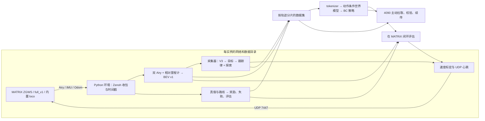

# MATRiX A 段导航采集与离线训练设计

目标是用 ZGWS 内置登阶运控采集有动作、有失败结局的轨迹，在 A100 上离线训练一个能以 5 Hz 输出机体速度的小模型。第一轮的 V4 策略只看双 Airy 生成的 BEV 序列。IMU、里程计用于配准，V3 教师还要读取自己的 13 维状态。保留该向量以便后续评估增加里程计输入的价值。下面给出的格式、时序和阈值是实现设计。本轮核对了 `284ecad` 的代码、权重旁的配置及 v1.1.2 发布文档，没有闭环运行数据。

## 每 200 ms 的观测与动作

1. 在每个实例内订阅实际发现的前后 Airy、IMU 和 Odom key。双 Airy 预设为 10 Hz，默认预设中的 IMU 为 500 Hz、Odom 为 100 Hz。以完整扫描的最后一点时间为可用时间，同时保留 Header 和本地单调接收时钟。第一次停稳测各时钟是否同域、速率和抖动。以经验证的传感器时钟设定 0.2 s 决策栅格，取截至栅格时刻已收到、时间配对的最新双扫描。先配相等 Header，容差须由实测时差、扫描周期和机器人运动界限共同给定。IMU/Odom 按同一时间轴插值至各点，边界只能用决策前可获样本。每个样本写入来源时间和延迟。缺一雷达、时钟跳变或积压超过一决策周期时，先发零速并截断该段，不能把断流标成碰撞。
2. 按 `PointCloud2.fields`、步长、行跨度、端序读取局部 FLU 米制 XYZ；丢弃非有限值。逐点 `timestamp` 是绝对秒，`frame_id=map` 仍表示传感器局部点。忽略含语义标签的 intensity。按实际配置的两个外参合到基座，利用 IMU 与相对里程计去畸变并水平化，保持 x 前、y 左。Odom 的 body twist 可供带误差的局部积分；世界系绝对 pose 仅送奖励端。无定位支路从回合原点积分机体速度和相对航向，增量注入 v8 量级漂移，避免把完美 MuJoCo 世界坐标带进 BEV。速度来源、姿态处理和噪声种子入元数据。发布参考见 `docs/LidarCameraProjection_CN.md:262–278,302–326` 和 `config/sensors/config_dual_airy_gpu.json:2–56`（后者相对发布包的 `UeSim/Content/model/`）。
3. 组装 BEV 后，V3 以保存的 `payload['nav4']['obs_space']` 创建 `DreamerPolicy(..., deterministic=True, obs=...).load(payload)`。以回合 ID 管理 carry，初帧置 `is_first`，末帧置 `is_last`。按 spec 给仅供解码的 `priv_*` 同形状零占位并做 `leakage_check`。mode 取动作分布的预测值，RSSM 仍有采样，记录种子。`state[0:7]` = 累计距离/1000、相对起点 yaw 的 cos/sin、pitch、roll、0、0（弧度、REP-103）；`[7:10]` = 机体实测 vx、vy、ωz；`[10:13]` = 上一个实际送到跟踪律的归一化 V3 目标，初始为 0。随机起点相对里程计从零开始，标注其与 v8 模拟已行驶里程初始化的差异，不能用出生站号补向量。依据 `nav4/env.py:147–182,407–428`、`nav4/policy.py:42–46,88–107,125–168`、`nav4/evaluate.py:186–204`。
4. V3 输出是归一化半径、方位、速度。对目标探索后调用 `nav4.common.action_target` 和 `nav4.tracker.command` 生成 `[vx,vy,ωz]`（m/s、m/s、rad/s），并用 `DreamerPolicy.executed(target_executed)` 更新 RSSM。保留同状态的干净目标和速度标签。首版在每个 5 Hz 边界计算一次速度，接下来重复同一命令，使一个转移只有一个动作；这是对原环境 20 Hz 重算局部目标的近似。记录转弯跟踪误差，独立按相同 5 Hz 接口评估教师。原 2.5D 模拟器的 `tracker.substep` 还模拟延迟、电机和积分，真实运控已经实现这些环节。v8 的 `speed_limit` 使用地图真值，教师若需坡道限速，采用 BEV 地面差估计并标记启用配置，禁止查地形真值。见 `nav4/common.py:50–57`、`nav4/tracker.py:14–29`、`nav4/env.py:118–124,269–289`。
5. 在确认登阶模式后分别给三轴小阶跃，拟合每一轴归一化摇杆量到 SI 指令范围、符号、死区、饱和、响应延时和实际速度，包括横移与转向耦合。固化标定版本及反映射。V4 输出三维归一化速度，由同一包装器限幅、还原 SI 指令并转摇杆量；标签为限幅后的指令，实际测得速度另存。内置 JSON `LY=forward, LX=-lateral, RX=-yaw`。独立墙钟心跳以 20 Hz 重发最后一条有效速度，有效期随新决策续订，决策逾期发零，避免持续执行旧动作。模拟时间走慢时先检查是否仍能满足该墙钟看门狗再纳入训练。UDP 0.5 s 超时、无回执，`sendto` 成功仅记为已发送。不能逐步调用原示例的 `move()`，它在结束时会触发平衡站立。见发布包 `Tools/matrix_mc_udp_test.py:24–32,68–94,114–132`、`docs/MOTION_CONTROL_CN.md:91–106`。

## 双 Airy 到 v1 BEV 的契约与验收

| 步骤 | 输入输出及复用边界 |
|---|---|
| 栅格 | `nav4.common.bev_index/bev_xy`，64×64，分辨率 0.125 m。第一维 x 覆盖 [−2,6) m，第二维 y 覆盖 [−4,4) m。范围按 v8 配置裁剪，去掉自身盲区，保留有效回波和未知掩码。见 `nav4/common.py:70–82`、`nav4/config/env.json:14–26`。 |
| 局部地面与障碍 | 每格用有效点找低/高包络；5×5 opening 的不可见邻居用可观测局部地面拟合填充且保持原始有效标记，支撑不足时输出未知。用邻近可见地面和外参/机身高度估算足底参考高；用相对垂向里程计或短时地面跟踪保持连续。地面相对机器人下方地面，障碍 = max(0, 高包络−地面)。按 `nav4.sensor.support_mask` 计算可支撑；对应主线的 1 m 基线平面、0.28 m 阶差、47° 坡度和 0.30 m 障碍阈值。 |
| 历史与量化 | 参考 `nav4/env.py:228–230,255–266,356–388,407–428`。在估计的局部里程计坐标系下维护 128×128、8 s 记忆，按整数格平移。同一格同帧的多个写入按通道逐项最大值，新鲜格覆盖旧格；用累计局部垂向参考把高度先转到共同基准再减回当前地面高。年龄 ≥8 s 标未知，未知把 terrain 三通道置 0。组装 `[地面高, 障碍高, 支撑, 未知, 0, 年龄/8]`，第五通道恒零。`nav4.common.encode` 按配置 clip、乘 255 并截断至 uint8，因地面 offset=0.5，未知时第一通道为 127。延迟队列 1 步；reset 输出且填充首张，向量按当前步读取。 |
| 可复用性限制 | `nav4/sensor.py:118–182` 是从地图 atlas 合成回波的模型，实际结合两部激光与一台前向深度相机；视野外的 opening 填充值和机器人下方 z 还读真值。检查点旁配置保留这个相机参数。双 Airy 版只替换测量前端，不调用原函数伪造点，不启用相机。玻璃/护栏、稀疏植被、台阶及遮挡造成的剩余域差须定量报告。 |

验收分三个层级，先验收前两个，再解释真实点云的差异。

- **同源金样**。合成平地、单阶、墙、坡、盲区和无回波；含重复落格、正负旋转、跨格平移、8 s 过期、延迟和 reset。在两端注入同一组 `measured,keep,z_ref,odom`，用冻结 v1 的记忆/量化路径逐帧对比，下游六个通道要求逐字节相同，向量按各槽与单位对齐。每帧检查 corridor 全零、未知时 support=0、shape/dtype/轴向。BEV 前端用位置已知的合成双云检验非有限过滤、外参、水平化和盲区。本步骤可以 CPU 合成数据执行。
- **隔离传感器差异**。用同一静态标靶分别生成等价点云与 nav4 可见表面，在两法共同可见且有地面支持的格上算地面/障碍高度 MAE（m）、support 混淆、unknown 比例；分别统计前/后扇区。用冻结 v1 同时产生“仅双雷达”的离线参考和原配置参考，量化去掉深度相机的失配。更换全局平移/yaw，扰动所有真值与 `priv_*`、奖励、出生站号，固定输入、种子后的 V3/V4 动作与编码特征差应为零。
- **MATRiX 验证（后续）**。先在 window_00 对平面、踏面/立面、扶手、硬墙各选已知控制点，测外参与点云命中，验证 A100 GPU Airy 看到导入的地形；再用同一短轨迹、同一时间与姿态离线回放两条前端。两端几何不同，按上述指标、年龄分布、每段教师动作差和按位置统计的失败率报告，保留空视野、急转、上/下阶样例。先排除轴反转、单位和时移，再用重复扫描方差与格宽设立实景容差。没有双云命中或模式证据时不进入正式采集。

## 奖励、终止和自动重置

私有 `full_v1/route.npz` 的 `station_m,xy_m` 来自构图时冻结的 `data/trail_a_v8_frozen/forward/map.npz`，依照 `nav4/matrix/full_scan.py:19–23` 插值 0…722 m、间距 0.05 m。`route_vs_v8.csv` 单独没有 XY。由 `assembly.json/shared_shift_m` 把已核对手性的 MATRiX MuJoCo 米制真值还原到扫描局部系（`p_scan = p_matrix + shared_shift_m`），以初始基座、前进和竖直方向三点独立验证。Odom 的 `T_world_base_link` 是可检验的真值候选，坐标、零点及精度须同静态和已知位移对上。使用上一站号为中心作局部线段投影，防止折返近邻跳站，保留有符号横偏 e。出生由已选站号初始化，仅供奖励器使用。见 `nav4/matrix/full_package.py:56–74,105–127`、`nav4/bank.py:141–154`。

建议初版奖励为 `2 clip(Δs,−0.5,0.5) − 0.001 − 0.05 mean((u_t−u_prev)²) − 0.03 (e/max(w_side,0.1))² − 15 I(failure)`。u 是限幅后的归一化速度，各项单存；首步平滑项置零。用 `route_vs_v8.csv` 的 `terrain_plus_hard_left_m/right_m` 插值对应侧 w_side（横向射线最远测至 2 m），两侧不对称。此为可复算的走廊近似，需在闭环误报人工抽样后冻结版本。成功以跨过 722 m 终点截面、在走廊内、同一步未失败为准，投影夹紧在末点须加前进方向检验。v1 的 gate/clearance 项暂不采用，不直接横比两边回报。依据 `nav4/env.py:293–315`、`nav4/matrix/full_checks.py:25–51,64–74`。

| 结局 | 信号与训练处理 |
|---|---|
| 跌落/踩空、撞硬物 | 优先用实测可用的接触、姿态、基座相对局部支撑面的高度并持续若干物理帧确认。把轮/足正常地面及台阶接触排除，软植被忽略。若无接触流，以校准的机身包络沿相邻真值位姿扫掠私有几何、支撑探针和姿态检测，记录 `label_source=geometry_proxy`；姿态/高度范围、冲击持续时间在平地/上下阶/已知硬接触上定标。只看 BEV 中障碍或一帧速度接近零不足以给失败标签。证据不足的异常截断并单列。 |
| 偏离、反向、卡住 | `abs(e)>w_side+0.35 m` 或反向退过历史最佳站号 2 m 为偏离；35 s 内未有至少 0.015 m 进展或超时记 code 5。按 nav4 原有超时语义设置截断。用 5 Hz 间的高频真值检查，优先级沿用踩空、碰撞、偏离、超时。 |
| 终点与基础设施 | 到终点或已确认物理失败设置 terminated；步数/卡住/流缺失/重启设置 truncated 并标原因。基础设施中断不生成虚构的末状态，裁掉未完整转移；只在有合法末观测时允许截断 bootstrap。区分 `arrived`、`terminated`、`truncated`。 |

reset 状态机依次执行零速、封存终止帧、切断旧命令、重建或复位机器人、清空 BEV/里程计/carry/同步队列、验证真值位姿与静止、进入站立和登阶、采首对双云，再允许决策。发布工具 `send_spawn_udp.py` 是道具生成示例，未给出机器人状态复位。若无可验证的在线 teleport+清运控历史，自动停止本实例，写实例私有 MJCF 中的出生位姿和相符的 `robot.position`，重新启动与创建机器人；启动若仍依赖 UI，需先验证能重复执行的离屏交互流程。每次用 fresh episode ID 和进程代数屏蔽重启前延迟包。运行时要能确认内置登阶状态在整个 episode 持续；独立 Robot_MC 的 18/20 线索不能当作内置接口成功证据。不能自动重置、创建或证明登阶时，只记录标定/诊断数据，停止批量采集。

## 轨迹覆盖与存储

按出生站分层覆盖短窗口、完整赛段和易失败区域。首批设计比例为干净教师 50%、在归一化目标上施加有界时间相关噪声 30%、每次插入 0.4–2 s 随机可行目标段后恢复教师 20%；保留正常全程起点，随机起点在静态支撑和净空可行时加小幅横偏与偏航。出生时不稳定另记 spawn 失败。按站段、干预源及碰撞/踩空/偏航/成功的回合数复核覆盖，空桶优先补采；训练报告给出最终分布。每个周期记录干净教师、实际执行目标和输出速度。BC 只在无切换、无噪声、状态/速度链路有效、质量验收通过的教师片段上拟合干净速度。世界模型使用所有有效转移和真实执行动作，含失败的最后一次转移。

每个 episode 用 UUID，按约一分钟切不可变 `.npz` 分片（允许跨片拼同回合，禁止跨回合采窗）。每片 T 次完整转移含 T+1 个观测，连续片共享一个有同一 obs_id 的边界观测。成员禁用 pickle；JSON 元数据记录维度、单位、schema 版本、哈希和 clip 上限。字段约定如下。

| 数组 | dtype / 第一维 | 含义 |
|---|---|---|
| `obs_id, obs_time_ns, recv_monotonic_ns, lidar_time_ns` | int64 [T+1]，双雷达时间 [T+1,2] | 决策时刻、到达时刻、已使用的前后云时间；另记 BEV 经延迟队列后的源时间。 |
| `bev, state_v3` | uint8 [T+1,64,64,6]、float32 [T+1,13] | 策略只读取白名单输入。训练时从 NHWC 转到上游所需布局；不用 RGB 增强和有损视频压缩。 |
| `target_teacher, target_executed, u_teacher, u_applied, cmd_si, stick_sent` | float32 [T,3] | 前两者均为 V3 目标域，u 为标定后的归一化速度，cmd 为限幅后 SI 指令，stick 顺序 LY/LX/RX。另记实际 UDP 发送时间/次数与测得 twist，UDP 无执行 ACK。 |
| `reward, reward_terms, terminated, truncated, arrived, bc_mask, source, failure` | float32 或 bool/uint8 [T,…] | 索引 t 对应 `obs[t] → u_applied[t] → obs[t+1]`，奖励/终止随该转移。保留全零以外的风险标签及缺失原因。 |
| `priv_pose, priv_station, priv_lateral, priv_clearance` | float32 [T+1,…]，pose 为米制 xyz+xyzw | 独立审计文件，供离线重算奖励、失败和评价。其文件句柄不交给 actor。 |
| manifest | 每片一条 JSON 记录 | run/episode/instance、序号、起止帧、各数据源缺包、seed、出生方式、行为混合、登阶证明、外参与速度标定、软件/地图/教师及权重 SHA、完整性哈希。只抽样留原始双云供重算。 |

拆分按赛段分组及 episode/seed 完整分配，地理留出另外标记；相邻重叠窗口、有同一初始条件的复本放同一组，排除跨分区滑窗。全程评估单独报告覆盖过的路线和严格地理留出，以免把邻近帧当泛化。首轮在冻结数据上完成 tokenizer、实际动作条件动力学和单独训练的 BC 头；报告按通道重建、动作改变时的多步预测、真实闭环行为，不以生成画面替代导航成绩。奖励/continuation 预测达到留出精度后才试想象 RL，先在失败少见状态检查乐观偏差。训练适配及预算见 [V4 调研](V4_SURVEY.md)。

## 多实例、评估与数据拉回

- 每个 worker 分配独立可写配置、用户目录、日志和回合号。若发布版支持分别配置所有监听端口，分配独立 TCP Zenoh、UDP 运控和所有附加服务，collector 显式连接实例端点并关跨实例发现。UDP 运控缺少公开的监听端口配置时，优先选择有独立网络栈的容器/namespace，每个实例连自己的 loopback，由 Unix IPC 或导出文件汇集；Colab 未必允许创建隔离网络，直接回退为单实例连续采集。端口重映射需覆盖两种协议；共用宿主网络时仅改 Zenoh TCP 端口无法隔离 UDP 控制。
- 先测单实例 window_00，再测 full 和第二实例。逐个增加并发，用单独点动证明只有目标实例的姿态变化、topic/日志/文件互不串扰。记录每实例 GPU 峰值、CPU/RAM 峰值、模拟秒/墙钟秒、每小时有效转移数、心跳间隔、成对扫描率、队列滞后和冷启动成本。当总有效吞吐不升、出现换页、显存不足或时序违约，则退回上一档。单实例 1× 实时且无停顿的理论上限为 18,000 步/小时，每步 64×64×6 原始 BEV 约 24 KiB，约 422 MiB/实例小时（不含可选原始云）。A100 上限未经实测。CPU V3 worker 可按实例批处理，维护独立 carry；慢实例单独截断，隔离时用带 episode/step ID 的 IPC 防止错配。V4 离线训练与采集分时占 GPU。
- 评估固定种子/初始位置/姿态和标定，配对跑 V3、BEV-only V4 和主线规则基线（使用地图/定位的一组另标上限）。严格从路线起点完整驾驶与随机窗口的结果分别汇报。每组给出分母、0 协助完成率、≤3 协助完成率、每 100 m 协助、失败类型和沿线分布、最大可靠到达站号、单位仿真与墙钟时间。协助只在严格回合单独计数后启用，以预先定义的下一个可行站重新初始化，记录人工搬运距离；协助越过终点不能算完成。全程用同一版本的奖励和完成判据。
- **同步由 4090 的 CPU 主动拉取。** VM 临时盘上，每片数据及模型/优化器/训练计数/RNG 一致快照先写 `.partial`，关文件并 fsync 后改名，再原子发布带序号、字节数和 SHA256 的清单。4090 每分钟读一次清单，训练器每五分钟落盘，至多十分钟发布一组恢复快照；先用已知的活动会话名 `colab download -s SESSION REMOTE_PATH LOCAL_PARTIAL` 拉清单和缺失文件，核对长度和 SHA 后再同盘原子改名，并记录已接收序号。失败退避，同名同 hash 跳过，校验失败仅重拉该片。每个输出根有随机 run UUID，恢复时检查 manifest 的 run UUID、数据 split 与权重哈希；新 VM 从 4090 的最后完整数据游标与 checkpoint 恢复。会话消失便停止轮询，避免调用可能自动创建会话的裸 `colab ssh`；留存完整文件后再回收 VM 端分片。该命令语法来自其他执行者保存的 `../matrix_v4_smoke/colab_download_help.log` 和 `colab_ssh_help.log`，本设计未连接会话。私有地图、轨迹、权重仅在明确授权的临时 VM 和 4090 的 Git 忽略路径流转；无 Google Drive、公共仓库或外部实验追踪上传。

## 会影响任务方向的风险

| 风险 | 下一轮的判定与处理 |
|---|---|
| A100 可计算但 UE Vulkan/OptiX 离屏和初始菜单不工作 | 确认硬件图形设备、实际 Airy 后端、双云/频率以及无需显示器的场景创建。无有效点云时暂停 V4 采集。 |
| ZGWS 内置登阶没有可编程入口或可验证的状态 | 核查每次 reset 的状态机日志和专门阶梯试验。缺证据时回报厂商接口缺口，保持所选运控，单独保留标定结果。 |
| 导入 MJCF 的物理地形与 UE 雷达命中表面不同 | 三控制点核对后再查护栏和台阶的高度/距离。不能用真值地图直接合成 BEV 遮蔽这个问题。 |
| 同步不稳、重置残余、横移/转向增益变化或假碰撞 | 仅完整因果片入库，按实例代数隔离，抽样审计失败前后几秒，按模式重新标定。 |
| 教师域差与模型在罕见失败上预测偏乐观 | 对比金样、原含深度观测的差异和 5 Hz 教师短跑；按失败源补数据。以 MATRiX 留出闭环为最终依据，12/3 封存前保持主线独立。 |
